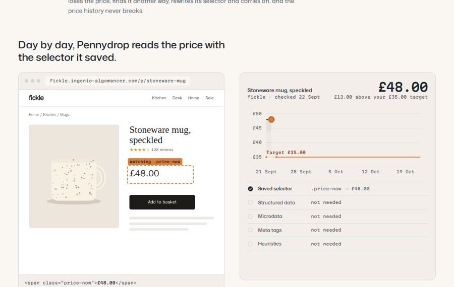
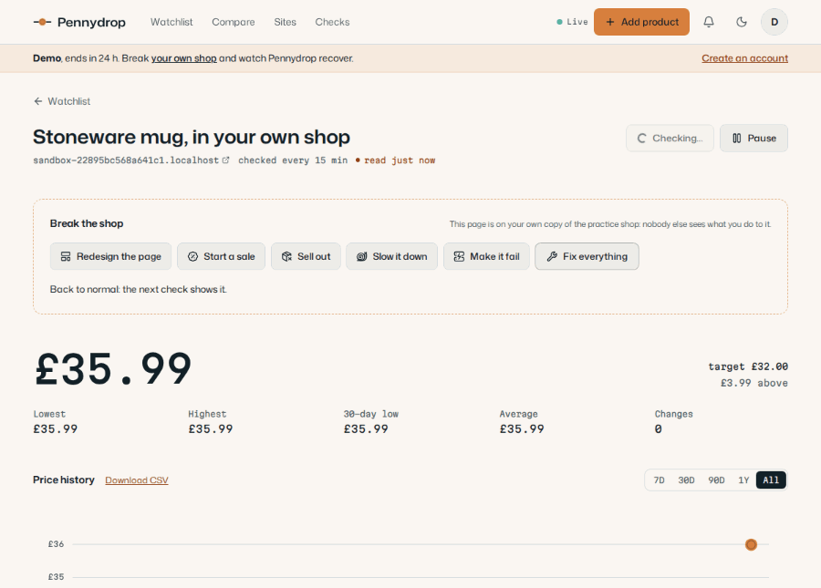
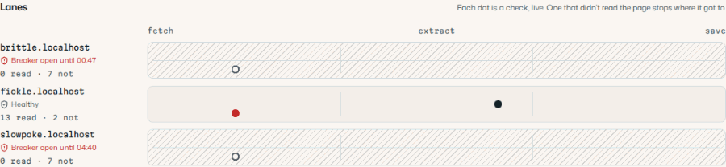
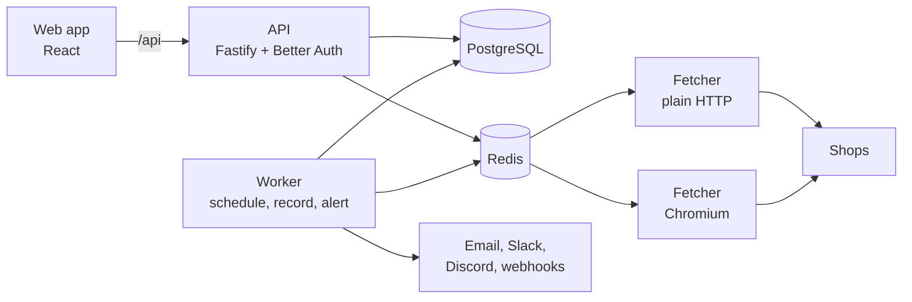

# Pennydrop

Price monitoring that notices when a shop redesigns its page, and keeps going.



Paste a product's address, click its price on a screenshot, set a target. Pennydrop checks
the page as often as the shop allows, keeps the price as the steps it really took, and tells
you by email, Slack, Discord or a signed webhook when it drops through your target.

- **Reads a price five ways:** a saved selector, the page's structured data, its microdata, its
  meta tags, and a scorer for price-shaped text. When the selector breaks, the others find the
  price and teach it a new one.
- **Polite to every shop:** robots.txt and its crawl delay, one request every 10 seconds at
  most, `Retry-After` obeyed, and a circuit breaker that leaves a struggling shop alone.
- **Alerts that don't cry wolf:** each change alerts each channel once, however many workers see
  it; a jump of more than half is checked twice first; a price wobbling round your target
  alerts once.
- **Honest history:** prices drawn as steps, never slopes; a sale's "was" price checked against
  what the shop really charged in the 30 days before.
- **A demo you can break:** one click, no account, and a copy of the practice shop of your own to
  redesign, slow down, knock over or put on sale.

## Break a shop, and watch it recover



The demo gives every visitor products with weeks of history and a practice shop of their own.
Measured locally, from opening the sign-in page: the redesign is healed on the timeline at
1.6 s, and the sale's alert drops into the bell at 3.5 s.

## The hard parts

### A page that changes its layout

Selectors break when shops redesign, and most monitors go quiet when they do. Pennydrop reads
every page every way it can and compares the answers. When the saved selector finds nothing but
another strategy finds the price on a product it has read before, it writes a new selector for
the whole site, records "layout changed" on the timeline, and the history doesn't break. A page
that lists many products (four or more prices built the same way, and no buy button) is never
mistaken for one, and never teaches the site a selector.

### One broken shop can't hold up the rest



Each site has its own gate in Redis (a minimum gap, and at most so many requests at once) and its
own circuit breaker. A worker that would have to wait for a site puts the job back for exactly
that long and takes another site's, rather than sleeping on a slot. A test proves it: 30 checks
of a healthy shop take 3.3–3.6 s alone, and 4.0–4.3 s beside a shop that hangs and another that
fails every time, with all 30 succeeding while the other two are left to their breakers.

### Alerts exactly once

A product's alert rules are locked while a new price is judged, and a product gets at most one
alert per price, so ten workers on the same price make one alert and one delivery per channel (a
test runs exactly that). Every delivery is its own job, retried after 1, 3, 8, 15 and 30 minutes;
a revoked webhook fails at once, and three failures in a row mark the channel broken and tell its
owner once. Quiet hours, a daily summary and an hourly cap hold alerts back and send them together.

### A fetcher that can't be turned against you

A price monitor fetches whatever address it's given, which makes it a way into private networks
unless it's careful. Every hop is checked: only http(s), only the usual ports, and after every DNS
lookup, never a private, loopback or link-local address, on redirects too. The browser's traffic
goes through a local proxy that applies the same guard. The fetchers have no route to the
database at all.

### History that tells the truth

Prices are stored as change points and drawn as steps; nothing is drawn before the first reading.
The demo's history is replayed from the practice shop's own past pages, through the real fetch
and extraction, and is drawn lighter and labelled "replayed", so nothing passes for an observation
it wasn't.

## Performance, measured

Each budget was set before the code. The pages' are measured against the production build in
Chromium, and the server's with `make perf`, all on an Apple M3 Pro in Docker, beside the rest of
the app:

| Budget                                                                                                      | Measured                                                                                                                                                            |
| ----------------------------------------------------------------------------------------------------------- | ------------------------------------------------------------------------------------------------------------------------------------------------------------------- |
| A watchlist of 100 products, every card shown: under 1.5 s on a desktop, 2.5 s on a mid-range phone over 4G | 0.19–0.20 s on a desktop. 2.07–2.11 s on a phone as Lighthouse models one (150 ms latency, 1.6 Mbps, CPU 4× slower)                                                 |
| The dashboard's JavaScript on a first visit, charts included: under 200 KB gzipped                          | 154.6 KB (137.7 KB as Brotli over the wire)                                                                                                                         |
| A year of one product's history (1,460 price changes): under 50 ms                                          | 7–8 ms median, 10–12 ms 95th percentile                                                                                                                             |
| Our own time per HTTP check, apart from the site's: under 100 ms for 95% of checks                          | The practice shop's page: 1–2 ms (95th percentile 2–3 ms). A 1 MB page: 62–66 ms median, 85–99.5 ms 95th percentile, 38 ms of it parsing the HTML as a browser does |
| A dispatcher tick with 10,000 products: under 200 ms                                                        | 1 ms with none due. With all due, 500 claimed and queued a tick: 70 ms median, 126 ms the slowest                                                                   |
| An alert within 60 seconds of the check that found the drop                                                 | Under 4 s: the demo's sale reaches the alerts bell 3.5 s after the sign-in page opens, its check included                                                           |

Measuring found two slow paths, both fixed: the stock check searched a whole reviews section once
for every review in it (24 seconds on a 670 KB page, now 3 ms), and the price scorer looked up the
position of every piece of text on the page, not just the prices.

## How it fits together



- **PostgreSQL owns the schedule.** A dispatcher claims due products every 15 seconds and queues
  their checks; Redis only holds the work in hand. A product page several people watch is checked
  once, at the shortest interval anyone asked for.
- **Plain HTTP first.** A browser check costs about 33 times as long and 400 MB of memory, so
  Chromium is used only when the price is written by JavaScript.
- **Live dashboards.** When a check lands, the worker says so on a Redis channel, and each API
  process tells the dashboards that watch that page, over Server-Sent Events.

## Built with

| Part     | What                                                                     |
| -------- | ------------------------------------------------------------------------ |
| App      | React 19, Vite 7, React Router 7, TanStack Query 5, Tailwind 4, GSAP     |
| API      | Fastify 5, Better Auth 1.7, Zod 4                                        |
| Data     | PostgreSQL 17 with Prisma 7, Redis 8.2 with BullMQ 5                     |
| Fetching | undici, Playwright 1.63 (Chromium)                                       |
| Practice | Express 5: one shop that answers as three, built to change and to break  |
| Tests    | Vitest 4, fast-check, Playwright Test with axe                           |
| Tooling  | Node 24, TypeScript 6, pnpm 10, Turborepo, ESLint 10, Prettier 3, Docker |

## Run it locally

Everything runs in Docker, so Docker is the only thing to install.

```sh
make setup   # first time: build, install packages, start everything
make seed    # the practice shops' products, to watch the pipeline work
make demo    # the demo's showcase, with 60 days of replayed history
make up      # start
make down    # stop
make help    # every command
```

Then open <http://localhost:3000> and press **Try the demo**.

| Address                          | What's there                                        |
| -------------------------------- | --------------------------------------------------- |
| <http://localhost:3000>          | The app                                             |
| <http://localhost:3001>          | The API (the app reaches it through `/api`)         |
| <http://localhost:8026>          | Mailpit: every email the app sends lands here       |
| <http://fickle.localhost:4000>   | The practice shop, healthy                          |
| <http://slowpoke.localhost:4000> | The same shop, slow on purpose                      |
| <http://brittle.localhost:4000>  | The same shop, failing on purpose                   |
| `/_chaos` on any shop            | Controls that change its layout, speed and failures |
| `localhost:55433`                | PostgreSQL, for a database GUI                      |

Set `ADMIN_EMAILS` in `.env` to see the System page at `/admin`.

## Run it in production

The production build is two images: one holds the API (which serves the built app), the worker,
the plain fetcher and the practice shop; the browser fetcher runs on Playwright's image.

```sh
cp .env.production.example .env.production   # then fill it in
make prod-up     # build, apply migrations, start everything
make prod-demo   # the demo's showcase
make prod-logs   # follow the logs
```

The API listens on this machine only (port 8080); a tunnel or proxy in front serves it over
HTTPS. Pages are sent with a strict content security policy (no inline scripts or styles, nothing
from another origin), and with HSTS once `APP_URL` is `https`. Production won't start without its
secrets or a way to send email. `.env.production.example` says how to rehearse the whole thing on
your own machine, end-to-end tests included.

- **Rendered ahead of time:** the front page, `/bot`, privacy and terms are rendered to HTML at
  build time, with their own titles, descriptions and a link-preview image, so search engines and
  previews read them without running anything, and a phone shows the front page before the app's
  code arrives. Their policy also allows the style attributes React wrote into them; they show
  nobody's data. Every other page is kept out of search results.

- **Backups:** a dump of the database every day, the last 14 kept on the server.
  `make prod-backup-test` restores the newest into a scratch database and compares it table by
  table. To keep a copy elsewhere, run this from another machine:
  `ssh server 'make -s -C pennydrop prod-backup-latest' > pennydrop.dump`. Keep `.env.production`
  somewhere safe too: without `CHANNELS_KEY`, saved alert channels can't be read.
- **A watchdog:** the API emails `ADMIN_EMAILS` when no check has read a page for 15 minutes, the
  schedule or a queue falls 10 minutes behind, a queue has no worker, or a day's backup is
  missed, once it has lasted two minutes, and again when it's put right. It runs in the API, so a
  dead worker can't silence it.
- **For an uptime monitor:** `/api/health` answers 503 when the database or Redis can't be
  reached.
- **Logs** are JSON lines from every service. A check keeps one job id from the fetcher's
  "checked" line to the worker's "recorded" line, which adds the check's id.

## Tests

```sh
make check          # formatting, lint, type checks, and 583 unit and integration tests
make test-browser   # 11 tests that need a real Chromium
make e2e            # 13 end-to-end tests at desktop and phone sizes, with axe on every page
make perf           # the server's performance budget, measured
```

Integration tests run against real PostgreSQL and Redis. CI runs all three on every push; the
end-to-end job starts the whole app from source.

## What's where

| Part                                   | What it does                                                                            |
| -------------------------------------- | --------------------------------------------------------------------------------------- |
| [`apps/web`](apps/web)                 | The dashboard, the landing page and the public pages                                    |
| [`apps/api`](apps/api)                 | Accounts, watches, alerts, the demo, the System page, live updates                      |
| [`apps/worker`](apps/worker)           | The schedule, recording checks, healing, alert rules and deliveries, replays, clean-ups |
| [`apps/fetcher`](apps/fetcher)         | Checks a page: plain HTTP first, Chromium when needed; previews with every price boxed  |
| [`apps/shop`](apps/shop)               | The practice shop: three layouts, three personalities, sandboxes, replays               |
| [`apps/e2e`](apps/e2e)                 | The end-to-end tests                                                                    |
| [`packages/extract`](packages/extract) | Reading a price five ways, and writing a new selector when a shop redesigns             |
| [`packages/fetch`](packages/fetch)     | Polite, guarded fetching: robots.txt, address cleaning, the private-network guard       |
| [`packages/alerts`](packages/alerts)   | Alert rules, messages, sealed channel settings, signed webhooks                         |
| [`packages/queue`](packages/queue)     | Job types, the per-site gate and circuit breaker in Redis                               |
| [`packages/db`](packages/db)           | The schema and migrations                                                               |
| [`packages/domain`](packages/domain)   | The rules the app and the API share                                                     |

Once it's running, the app's `/bot` page explains how Pennydrop behaves towards a shop, and how a
shop can turn it away.
